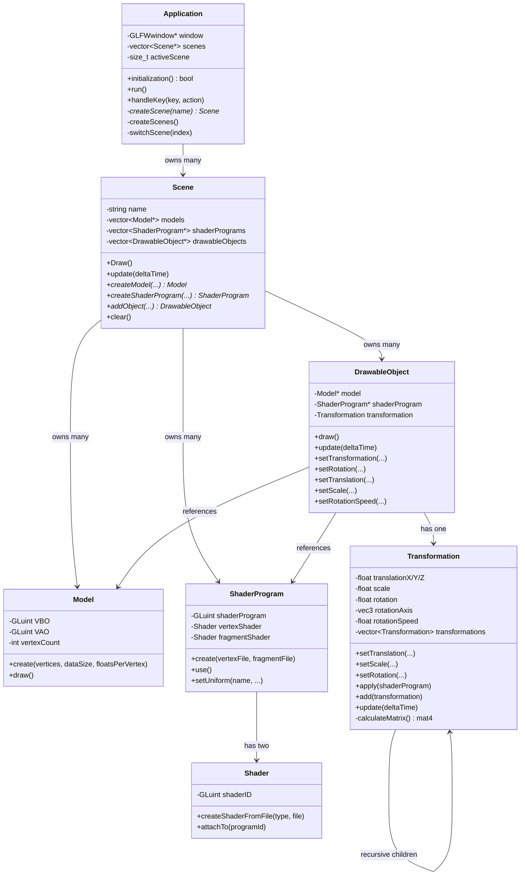
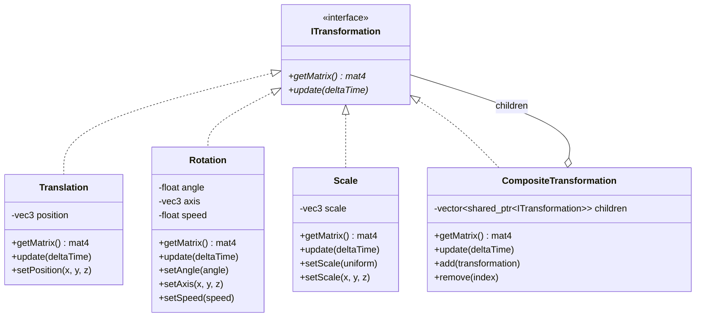
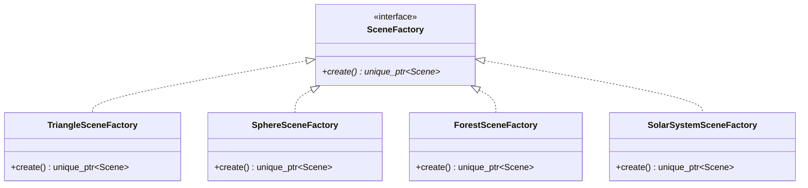
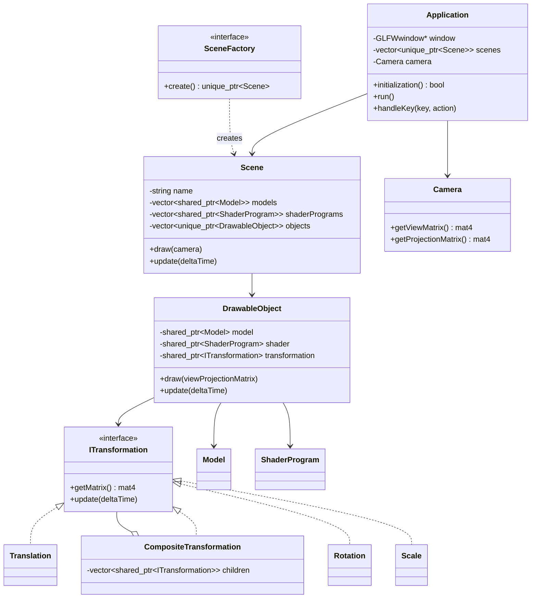
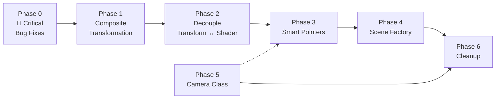

# 🔧 ZPG Refactoring Plan

## Current Architecture Overview



---

## 🔴 Diagnosed Problems

### 🐛 Critical Bugs

### 1. **Cross-Scene Resource Contamination (USE-AFTER-FREE)**
In [`Application.cpp`](file:///C:/Users/Andreas/Documents/ZPG/RN%20implementace/ZPG/Application.cpp#L183):
- Line 183: `loginModelB3` is created via `triangleScene->createModel(...)` but used in `forestScene` (line 220)
- Line 215: `sunProgram` is created via `sphereScene->createShaderProgram(...)` but used in `forestScene` (line 216)

If scenes are deleted independently, the owning scene deletes the resource while the other scene still references it → **dangling pointer / crash**.

### 2. **`Model::create()` ignores `floatsPerVertex` — buffer overread**
[`Model.cpp:14`](file:///C:/Users/Andreas/Documents/ZPG/RN%20implementace/ZPG/Model.cpp#L14): `vertexCount = dataSize / (6 * sizeof(float))` — hardcoded `6` instead of using `floatsPerVertex`. For 9-float models (`sun`, `earth`, `moon`), this calculates **1.5× too many vertices**, causing `glDrawArrays` to read past the buffer into unallocated GPU memory.

### 3. **Missing shader link status check (silent failure)**
[`ShaderProgram.cpp:33`](file:///C:/Users/Andreas/Documents/ZPG/RN%20implementace/ZPG/ShaderProgram.cpp#L33): `glLinkProgram()` is called but `GL_LINK_STATUS` is never checked. Linking errors fail **completely silently** — black screen, no error message.

### 4. **ODR violations in model headers**
[`BRU0098.h`](file:///C:/Users/Andreas/Documents/ZPG/RN%20implementace/ZPG/Models/BRU0098.h) and `OpenGL.h` declare non-const, non-static, non-inline global arrays (`float bru0098[] = {...}`). Including them in two `.cpp` files violates the One Definition Rule → **linker error or undefined behavior**.

### 5. **High-DPI viewport bug**
[`Callbacks.cpp:26`](file:///C:/Users/Andreas/Documents/ZPG/RN%20implementace/ZPG/Callbacks.cpp#L26): Uses `glfwSetWindowSizeCallback` which gives **screen coordinates**, but `glViewport` needs **framebuffer pixel dimensions**. On high-DPI displays these differ → distorted rendering.

---

### 🏗️ Architecture Issues

### 6. **God Method: `Application::createScenes()`** (~160 lines)
All scene construction logic is hardcoded in a single monolithic method. Adding a new scene means editing this function, violating Open/Closed Principle.

### 7. **`Transformation` is a God Class with dual identity**
It tries to be both a **leaf transformation** (translate/rotate/scale) AND a **composite container** (`std::vector<Transformation> transformations`). This creates confusion — every `Transformation` carries unused composite machinery or unused leaf fields.

### 8. **Tight coupling: `Transformation` → `ShaderProgram`**
[`Transformation::apply()`](file:///C:/Users/Andreas/Documents/ZPG/RN%20implementace/ZPG/Transformation.cpp#L31-L34) directly calls `shaderProgram->setUniform()`. Transformation (a math concept) shouldn't know about GPU shader APIs.

### 9. **Raw `new`/`delete` everywhere — no RAII**
[`Scene`](file:///C:/Users/Andreas/Documents/ZPG/RN%20implementace/ZPG/Scene.h) manages `Model*`, `ShaderProgram*`, `DrawableObject*` with raw pointers and manual `delete` loops. Same in [`Application`](file:///C:/Users/Andreas/Documents/ZPG/RN%20implementace/ZPG/Application.cpp#L40-L44) for `Scene*`.

### 10. **Rule of 3/5 violations across multiple classes**
`Model`, `Shader`, `ShaderProgram`, `Scene`, and `Application` all manage OpenGL handles or heap memory in destructors but lack deleted/custom copy constructors and assignment operators. Copying any of these classes causes **double-free of OpenGL resources**.

### 11. **Model data embedded in header files**
Huge float arrays (e.g., [`sphere.h`](file:///C:/Users/Andreas/Documents/ZPG/RN%20implementace/ZPG/Models/sphere.h) = 220KB, `tree.h` = 5.5MB) are compiled into every translation unit that includes them. Slow compiles and bloated binaries.

### 12. **No Camera / View / Projection**
All rendering is in clip-space with no Camera class. The shaders have no `viewMatrix` or `projectionMatrix` — any window resize distorts aspect ratios.

### 13. **`DrawableObject` is a pass-through layer**
Every setter on [`DrawableObject`](file:///C:/Users/Andreas/Documents/ZPG/RN%20implementace/ZPG/DrawableObject.h) just calls the same method on `Transformation`. It adds no value.

### 14. **Duplicated legacy code + dead code**
[`mainCV2.cpp`](file:///C:/Users/Andreas/Documents/ZPG/RN%20implementace/ZPG/mainCV2.cpp) is a 258-line monolithic legacy file. [`right.vert`](file:///C:/Users/Andreas/Documents/ZPG/RN%20implementace/ZPG/shaders/right.vert) has 21 lines of commented-out dead code. `Shader.cpp` calls `exit()` on errors instead of throwing or returning.

### 15. **Redundant `use()` calls + no uniform location caching**
[`ShaderProgram`](file:///C:/Users/Andreas/Documents/ZPG/RN%20implementace/ZPG/ShaderProgram.cpp#L42-L73): Every `setUniform()` call re-invokes `glUseProgram()` and re-queries `glGetUniformLocation()` every frame. Wastes CPU.

---

## 🟢 Refactoring Plan — Phased Execution

### Phase 0: Critical Bug Fixes 🚨
> **Goal**: Fix bugs that cause crashes, undefined behavior, or silent failures — before any architectural changes.

| Bug | Fix | File |
|-----|-----|------|
| Cross-scene resource contamination | Move `loginModelB3` and `sunProgram` creation to `forestScene` instead of `triangleScene`/`sphereScene` | [`Application.cpp:183,215`](file:///C:/Users/Andreas/Documents/ZPG/RN%20implementace/ZPG/Application.cpp#L183) |
| Vertex count ignores `floatsPerVertex` | `vertexCount = dataSize / (floatsPerVertex * sizeof(float))` | [`Model.cpp:14`](file:///C:/Users/Andreas/Documents/ZPG/RN%20implementace/ZPG/Model.cpp#L14) |
| Missing link status check | Add `glGetProgramiv(prog, GL_LINK_STATUS, &success)` + error log | [`ShaderProgram.cpp:33`](file:///C:/Users/Andreas/Documents/ZPG/RN%20implementace/ZPG/ShaderProgram.cpp#L33) |
| ODR violations in model headers | Add `const` to `bru0098[]` and `opengl[]` declarations | `Models/BRU0098.h`, `Models/OpenGL.h` |
| High-DPI viewport bug | Change `glfwSetWindowSizeCallback` → `glfwSetFramebufferSizeCallback` | [`Application.cpp:117`](file:///C:/Users/Andreas/Documents/ZPG/RN%20implementace/ZPG/Application.cpp#L117), [`Callbacks.cpp:26`](file:///C:/Users/Andreas/Documents/ZPG/RN%20implementace/ZPG/Callbacks.cpp#L26) |
| `exit()` in Shader on errors | Replace `exit()` calls with `throw` or return error codes | [`Shader.cpp`](file:///C:/Users/Andreas/Documents/ZPG/RN%20implementace/ZPG/Shader.cpp) |
| Rule of 3/5 violations | Add `= delete` for copy ctor/assignment on `Model`, `Shader`, `ShaderProgram` | Multiple headers |

**Files touched:** `Application.cpp`, `Model.cpp`, `ShaderProgram.cpp`, `Shader.cpp`, `Callbacks.cpp`, `Models/BRU0098.h`, `Models/OpenGL.h`, `Model.h`, `Shader.h`, `ShaderProgram.h`

---

### Phase 1: Composite Transformation Pattern ⭐
> **Goal**: Clean separation of concerns for transformations. Each transform type is a single-responsibility leaf; they compose into trees.



**Changes to existing classes:**
- **Keep** `Transformation.h/.cpp` — **rename** the class to `CompositeTransformation`, keep it as the composite node
- **Extract** `Translation`, `Rotation`, `Scale` as new leaf classes implementing `ITransformation`
- **Remove** `apply(ShaderProgram*)` from transformation — matrix calculation is pure math, the `DrawableObject` sends it to the shader

**Example usage (the solar system from the commented-out code):**
```cpp
auto orbit    = std::make_shared<Rotation>(0.0f, glm::vec3(0,0,1), 0.5f);
auto offset   = std::make_shared<Translation>(0.5f, 0.0f, 0.0f);
auto spin     = std::make_shared<Rotation>(0.0f, glm::vec3(0,1,0), 1.5f);
auto size     = std::make_shared<Scale>(0.08f);

auto earthTransform = std::make_shared<CompositeTransformation>();
earthTransform->add(orbit);
earthTransform->add(offset);
earthTransform->add(spin);
earthTransform->add(size);

earthObject->setTransformation(earthTransform);
```

**Files touched:** `Transformation.h/cpp` (refactored), new: `ITransformation.h`, `Translation.h/cpp`, `Rotation.h/cpp`, `Scale.h/cpp`, `CompositeTransformation.h/cpp`

---

### Phase 2: Decouple Transformation from ShaderProgram
> **Goal**: Transformation returns `glm::mat4`, drawing code sends it to the shader.

**Before:**
```cpp
// DrawableObject::draw()
transformation.apply(shaderProgram);  // Transformation knows about ShaderProgram!
```

**After:**
```cpp
// DrawableObject::draw()
glm::mat4 modelMatrix = transformation->getMatrix();
shaderProgram->setUniform("modelMatrix", modelMatrix);
```

**Files touched:** `DrawableObject.cpp`, `Transformation.h/cpp` (remove `apply()`)

---

### Phase 3: Smart Pointers (RAII)
> **Goal**: Eliminate all `new`/`delete`, use `std::unique_ptr` and `std::shared_ptr`.

| Class | Pointer Type | Rationale |
|-------|-------------|-----------|
| `Scene` stores `Model` | `unique_ptr<Model>` | Scene exclusively owns models |
| `Scene` stores `ShaderProgram` | `shared_ptr<ShaderProgram>` | Multiple objects may share a shader |
| `Scene` stores `DrawableObject` | `unique_ptr<DrawableObject>` | Scene exclusively owns objects |
| `Application` stores `Scene` | `unique_ptr<Scene>` | Application exclusively owns scenes |
| `DrawableObject` → `Model` | `shared_ptr<Model>` | Multiple objects share the same model |
| `DrawableObject` → `ShaderProgram` | `shared_ptr<ShaderProgram>` | Multiple objects share the same shader |
| `DrawableObject` → `ITransformation` | `shared_ptr<ITransformation>` | Composite tree with shared nodes (orbits) |

**Files touched:** `Scene.h/cpp`, `Application.h/cpp`, `DrawableObject.h/cpp`

---

### Phase 4: Scene Factory Pattern
> **Goal**: Each scene is built by a dedicated factory function/class, eliminating the `createScenes()` god method.



**Before:**
```cpp
void Application::createScenes() {
    // 160 lines of interleaved scene construction...
}
```

**After:**
```cpp
void Application::createScenes() {
    registerFactory<TriangleSceneFactory>();
    registerFactory<SphereSceneFactory>();
    registerFactory<ForestSceneFactory>();
    registerFactory<SolarSystemSceneFactory>();
    
    for (auto& factory : factories) {
        scenes.push_back(factory->create());
    }
}
```

**New files:** `SceneFactory.h`, `TriangleSceneFactory.h/cpp`, `SphereSceneFactory.h/cpp`, `ForestSceneFactory.h/cpp`, `SolarSystemSceneFactory.h/cpp`

---

### Phase 5: Camera Class Foundation
> **Goal**: Add Camera class for proper 3D rendering with perspective projection.

**Add Camera class** (prepares for proper 3D rendering):
```cpp
class Camera {
public:
    glm::mat4 getViewMatrix() const;
    glm::mat4 getProjectionMatrix() const;
    void setPosition(glm::vec3 pos);
    void setTarget(glm::vec3 target);
    void setPerspective(float fov, float aspect, float near, float far);
private:
    glm::vec3 position, target, up;
    float fov, aspect, nearPlane, farPlane;
};
```

**New files:** `Camera.h/cpp`
**Modified:** `Model.cpp`

---

### Phase 6: Cleanup
> **Goal**: Remove dead code, fix style inconsistencies.

| Task | File |
|------|------|
| Delete `mainCV2.cpp` (legacy monolith) | `mainCV2.cpp` |
| Remove commented-out old shader in `right.vert` | `shaders/right.vert` |
| Remove `using std::vector` from headers (pollutes namespace) | `Scene.h` |
| Consider moving model data to binary `.bin` files loaded at runtime | `Models/*.h` |
| Consistent line endings (mix of CRLF and LF) | All files |
| Fix `DrawableObject` pass-through methods | `DrawableObject.h/cpp` |

---

## 📐 Target Architecture



---

## ⏱️ Execution Order & Dependencies



> **Phase 0 → 1 → 2 → 3 → 4** is the critical path. Phase 5 can run in parallel after Phase 2. Phase 0 should be done first to establish a correct baseline.

---

## 🎨 Visual Output Idea: Solar System Scene

After refactoring, the composite pattern enables this scene elegantly:

```
╔════════════════════════════════════════════════════╗
║                                                    ║
║        ·  ·  ·                                     ║
║      ·          ·           ☽ ← Moon orbits Earth  ║
║    ·    ☀ Sun     ·       ↗                        ║
║    ·   (rotates)   · 🌍 Earth                      ║
║    ·               ·  (orbits Sun + self-rotates)   ║
║      ·           ·                                  ║
║        ·  ·  ·                                      ║
║                                                    ║
║   Composite tree:                                  ║
║   Earth = [SunOrbit → Offset → SelfSpin → Size]   ║
║   Moon  = [SunOrbit → Offset → MoonOrbit →         ║
║            MoonOffset → MoonSpin → MoonSize]        ║
╚════════════════════════════════════════════════════╝
```

**The composite transformation tree for this scene:**


> [!TIP]
> Notice how the Earth's orbital rotation node can be **shared** between the Earth and Moon composite trees — the Moon inherits Earth's orbital position before adding its own orbit on top. This is the power of the Composite pattern with `shared_ptr`.

### Color Scheme for the Solar System

| Object | Shader | Color |
|--------|--------|-------|
| ☀ Sun | `basic.frag` (flat yellow) | `vec4(1.0, 0.9, 0.2, 1.0)` |
| 🌍 Earth | New `earth.frag` | Blue-green normals mapped to color |
| ☽ Moon | New `moon.frag` | `vec4(0.7, 0.7, 0.7, 1.0)` gray |
| ✨ Background | Dark clear color | `glClearColor(0.02, 0.02, 0.08, 1.0)` — deep space blue |

### Additional visual ideas for other scenes:

1. **Forest scene** — Add slight random rotation per tree for organic look, bushes slightly swaying (oscillating rotation via `sin(time)`)
2. **Particle ring** — Array of small spheres in a ring around the sun, each with slightly different orbit speed — looks like Saturn's rings
3. **Interactive**: Arrow keys rotate the camera (once Camera class exists), giving a real 3D feel

---

## Files Summary

| Action | File | Phase |
|--------|------|-------|
| **Fix** | `Application.cpp` (cross-scene bug) | 0 |
| **Fix** | `Model.cpp` (vertex count bug) | 0 |
| **Fix** | `ShaderProgram.cpp` (link check) | 0 |
| **Fix** | `Models/BRU0098.h`, `Models/OpenGL.h` (ODR) | 0 |
| **Fix** | `Callbacks.cpp` (framebuffer callback) | 0 |
| **Fix** | `Shader.cpp` (remove exit()) | 0 |
| **Fix** | `Model.h`, `Shader.h`, `ShaderProgram.h` (Rule of 5) | 0 |
| **New** | `ITransformation.h` | 1 |
| **New** | `Translation.h/cpp` | 1 |
| **New** | `Rotation.h/cpp` | 1 |
| **New** | `Scale.h/cpp` | 1 |
| **New** | `CompositeTransformation.h/cpp` | 1 |
| **Modify** | `Transformation.h/cpp` → rename/refactor | 1 |
| **Modify** | `DrawableObject.h/cpp` | 2, 3 |
| **Modify** | `Scene.h/cpp` | 3 |
| **Modify** | `Application.h/cpp` | 3, 4 |
| **New** | `SceneFactory.h` | 4 |
| **New** | `TriangleSceneFactory.h/cpp` | 4 |
| **New** | `SphereSceneFactory.h/cpp` | 4 |
| **New** | `ForestSceneFactory.h/cpp` | 4 |
| **New** | `SolarSystemSceneFactory.h/cpp` | 4 |
| **Modify** | `Model.cpp` (bug fix) | 5 |
| **New** | `Camera.h/cpp` | 5 |
| **Delete** | `mainCV2.cpp` | 6 |
| **Modify** | `shaders/right.vert` (clean) | 6 |
| **Modify** | `Scene.h` (remove `using`) | 6 |
| **New** | `shaders/earth.frag` | Visual |
| **New** | `shaders/moon.frag` | Visual |
